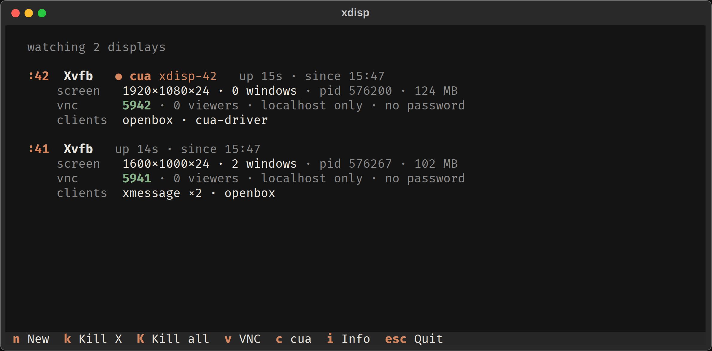

# xdisp

A terminal dashboard for headless X displays. It shows every Xvfb display that is running,
its VNC port, screen size, uptime and what's running on it. It can start or kill displays 
all from one place.

It finds every display on the box, including ones `xdisp` didn't start (xvfb-run, scripts, cua). 



## Install

[Install uv](https://docs.astral.sh/uv/getting-started/installation/)

```bash
apt install git curl xvfb x11vnc x11-utils openbox
```

Then

```bash
uv tool install git+https://github.com/SpikedCola/xdisp
```

Or run it without installing:
```bash
git clone https://github.com/SpikedCola/xdisp
cd xdisp
uv run xdisp
```
